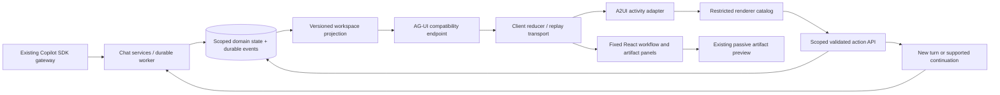

# RCI Agent interactive workspace: AG-UI + A2UI research and integration recommendation

Research date: 2026-10-22  
Scope: architecture research, not implementation. Local baseline: commit `ac41e0c826bbf8076cc6446b07ce42ca94b47b50`; `AGENTS.md` is the only reported untracked file.

## Executive summary

**Use AG-UI as an interoperability boundary for agent events and shared state; use ordinary React for the permanent workflow/artifact workspace; introduce A2UI selectively for dynamic forms, clarification cards, and task-specific interactions.** AG-UI and A2UI are complementary, not competing replacements: AG-UI describes agent/user interaction events, while A2UI describes catalog-constrained surfaces, components, data, and actions.[^ag-events][^a2-protocol] RCI Agent already has durable tasks, replayable events, published artifact metadata, and basic task/artifact cards, so replacing its chat, worker, or preview infrastructure would add unnecessary risk.[^local-events][^local-ui] The important integration work is an authoritative server-side state projection, reconnect-safe delivery, and validated/idempotent user actions—not merely connecting two SDKs.[^ag-encoder][^local-transactions] A2UI is viable for a bounded pilot, but its protocol/package versions and renderer support must be pinned together; do not equate a stable protocol-family label with blanket production readiness.[^a2-status][^a2-renderers]

## 1. Findings and decision

### What each technology owns

| Layer | Responsibility | What it does not supply |
| --- | --- | --- |
| RCI Agent domain | Chat ownership/scope, task execution, artifacts, durable state, action authorization | A general agent-authored UI language |
| AG-UI | Run/message/tool/state/activity events and run input; typed agent interaction boundary | A component renderer, database, or built-in durable replay cursor |
| A2UI | Declarative surfaces, component catalogs, bound data, user-action descriptions | Task scheduling, durable approval storage, authorization |
| React application shell | Layout, navigation, permanent status/artifact panels, accessibility, trusted controls | Automatic agent checkpoint/resume |
| Existing artifact preview | Passive, saved HTML document preview/download | A place to execute interactive agent UI |

The protocol distinctions are documented in AG-UI's event/state definitions and A2UI's transport, surface, and action specifications. RCI Agent's current opaque artifact iframe is an independent security boundary and should remain one.[^ag-events][^ag-state][^a2-protocol][^local-artifacts]

### Recommended choice

**Recommended: a hybrid, incremental integration—not “render the entire application through A2UI.”**

| Approach | Fit for this repository | Recommendation |
| --- | --- | --- |
| Fixed React panels on current API/SSE | Lowest-change route to workflow status and artifact navigation | Build first |
| Direct AG-UI adapter + fixed React + optional A2UI | Preserves backend/SDK and gives future protocol interoperability | Target architecture |
| A2UI for every status/navigation control | Makes authoritative operational UI depend on model-generated layout | Avoid |
| CopilotKit-managed frontend/runtime integration | Useful packaged activity rendering and action plumbing, but additional runtime/API adoption | Consider only if broader framework adoption is desired |

AG-UI's client is framework-independent, A2UI's official React package declares React 18/19 compatibility, and CopilotKit provides a real A2UI activity/action bridge. None requires replacing RCI Agent's existing Copilot SDK inference gateway with ADK, A2A, or a different model framework.[^ag-client][^a2-package][^bridge][^ag-server]

**Why keep permanent panels in React?** Their contents are already structured application facts: task state, stages, retries, and published artifact versions. They should remain available even when inference fails, a surface is invalid, or no model-generated UI is present. A2UI earns its complexity when a skill needs to compose a task-specific input surface—not when the app needs to list files it already knows about.[^local-ui][^local-snapshot][^a2-protocol]

## 2. Current RCI Agent integration seams

The following are repository findings, not proposed capabilities:

- **Durable backend:** separate API and worker; one globally executing background task and one active turn per chat. Expired running work is interrupted and requires explicit retry.[^local-tasks]
- **Existing replay:** per-turn events have integer database IDs; the SSE route accepts `after`/`Last-Event-ID`, and the frontend rejects malformed events and drops already-seen IDs.[^local-events]
- **Existing state projection:** `GET /api/chats/{id}` returns a chat snapshot containing tasks and all published artifacts, including version/parent metadata. No new artifact-version endpoint is necessary just to build a navigator.[^local-snapshot]
- **Existing UI:** inline `TaskCard`s and artifact cards, plus one selected artifact preview. The proposed workspace is largely a presentation improvement over data already available.[^local-ui]
- **Different disconnect semantics:** a claimed foreground response is cancelled when its serving stream closes; background tasks survive browser disconnects. A passive side-panel subscription must not accidentally claim or cancel foreground execution.[^local-stream]
- **No present protocol integration:** researchers found no AG-UI/A2UI implementation or durable human-interaction/continuation model in the repository. Those would be new features, not configuration switches.[^local-contracts][^local-models]

### Proposed workspace

```text
┌──────────────┬──────────────────────────┬─────────────────────────┐
│ Chats        │ Main conversation        │ Workspace               │
│              │                          │ Workflow | Artifacts    │
│              │ Streaming answers        │ | Inputs                │
│              │                          │                         │
│              │ Composer                 │ Fixed status/artifacts  │
│              │                          │ Optional A2UI surface   │
└──────────────┴──────────────────────────┴─────────────────────────┘
                  Existing passive document preview opens separately
```

This layout is a design proposal. Keep artifact navigation separate from artifact-context selection: opening a navigator, closing a preview, and selecting a version must not silently change which artifact is sent on the next chat turn. Existing `App` selection/context behavior is the compatibility baseline.[^local-ui]

## 3. AG-UI: strengths, limits, and mapping

### Protocol fit

At the inspected AG-UI commit, the protocol includes `RUN_*`, `TEXT_MESSAGE_*`, `TOOL_CALL_*`, `STATE_SNAPSHOT`/`STATE_DELTA`, `MESSAGES_SNAPSHOT`, `ACTIVITY_SNAPSHOT`/`ACTIVITY_DELTA`, and custom events. State deltas use JSON Patch. Activities provide structured non-text message content and are a suitable carrier for a dynamic UI surface.[^ag-events][^ag-state]

AG-UI's Python encoder emits:

```python
return f"data: {event.model_dump_json(by_alias=True)}\n\n"
```

That source has no SSE `id:` emission. **A successful AG-UI connection is not a durable subscription implementation.** Retain RCI Agent's cursor/replay responsibilities explicitly rather than assuming that an `HttpAgent` automatically restores its current behavior.[^ag-encoder][^ag-http][^local-events]

### Proposed mapping

| RCI Agent concept | Proposed AG-UI representation | Important qualification |
| --- | --- | --- |
| Chat | `threadId` | Resolve and authorize server-side |
| Executing turn/attempt | `runId` | A retry/continuation is a new execution identity |
| Assistant output | Text message start/content/end | Persist a stable message ID; close it exactly once |
| Queued/running/stage/task outcomes | State snapshots/deltas | Server-owned application facts |
| Published artifacts | State projection of artifact metadata | Keep document bytes on existing scoped routes |
| Verified tool lifecycle | Tool-call events | Current “Using tool” status text is not complete arguments/result telemetry |
| Skill-specific interactive surface | Activity snapshot carrying A2UI operations | Explicit application/bridge convention |
| Failure | `RUN_ERROR`, plus domain status | Do not turn failures into successful empty state |

This mapping is proposed, grounded in RCI Agent's narrower event union and AG-UI's richer event vocabulary. In particular, do not fabricate tool arguments or infer precise task progress percentages from prose stage labels.[^local-contracts][^ag-events]

### Interrupt/resume is not reconnect

AG-UI 1.0 defines an interrupt outcome on `RUN_FINISHED`; a later **new run** on the same thread submits `resume` entries correlated by `interruptId`. Its documented rules cover pending interrupts, expiry, and idempotency. That is a business continuation contract, not TCP/SSE replay, and it does not implement a Copilot SDK checkpoint for this application.[^ag-interrupts]

For the initial integration, prefer RCI Agent's existing clarification pattern: the agent asks a question, ends the turn, and the user supplies a new reply. Add durable interrupt semantics only when a requirement actually needs a persisted interaction with a controlled continuation.[^local-worker][^ag-interrupts]

## 4. A2UI: rendering and compatibility

### Supported model

A2UI's v0.9-family server messages create a surface, update a flat component graph, update its data model, or delete the surface. Components reference a negotiated catalog; the catalog identifier is not an instruction to fetch and execute arbitrary code. Inputs can update client-local bound values, while actions provide the explicit user-to-server boundary.[^a2-protocol]

Official-message-style example, simplified for this proposal:

```json
[
  {
    "version": "v0.9",
    "createSurface": {
      "surfaceId": "requirements-clarification",
      "catalogId": "rci-agent://catalog/clarification-v1"
    }
  },
  {
    "version": "v0.9",
    "updateComponents": {
      "surfaceId": "requirements-clarification",
      "components": [
        {"id": "root", "component": "Column", "children": ["question"]},
        {"id": "question", "component": "Text", "text": {"path": "/question"}}
      ]
    }
  },
  {
    "version": "v0.9",
    "updateDataModel": {
      "surfaceId": "requirements-clarification",
      "path": "/",
      "value": {"question": "Which delivery region should the proposal cover?"}
    }
  }
]
```

The custom catalog URI and question are proposed, not a shipped RCI Agent catalog. Message structure and binding syntax follow the inspected v0.9 examples; v1.0 binding syntax differs, so never mix examples across protocol generations.[^a2-protocol][^a2-versions]

### Real renderer entry points

Verified source APIs include:

```typescript
import { MessageProcessor, basicCatalog } from '@a2ui/web_core/v0_9'
import { A2uiSurface } from '@a2ui/react/v0_9'
```

`MessageProcessor` accepts a catalog array and an optional action listener, and exposes `processMessages`; `A2uiSurface` receives a surface model. These are source-verified API entry points, **not a complete tested RCI Agent integration**. `basicCatalog` is exported by web core, not the React entry point. For RCI Agent, register a restricted custom catalog rather than shipping the full basic catalog unchanged.[^a2-api]

### Maturity and package selection

Researchers verified `@ag-ui/client` 1.0.3, Python `ag-ui-protocol` 1.0.0, and `@a2ui/react` 0.14.0 at research time. These package versions are not the A2UI wire version: the A2UI repository identifies v0.9.1 as its current production protocol release and v1.0 as a candidate; the project also retains an early-public-preview warning.[^ag-client][^registries][^a2-package][^a2-status]

**Documentation discrepancy:** one inspected renderer compatibility table marks React's v1.0 support as planned, while the roadmap labels React generally stable and source contains v1.0 tests. Those statements describe different levels of readiness and do not prove an integrated v1.0 production path. Target a tested v0.9-family combination initially; confirm the exact v0.9/v0.9.1 envelope accepted by the selected package in the POC.[^a2-renderers][^a2-roadmap][^a2-v1-tests]

## 5. Composing the protocols

A verified CopilotKit bridge carries A2UI operations in an AG-UI activity:

```json
{
  "type": "ACTIVITY_SNAPSHOT",
  "messageId": "a2ui-surface-requirements",
  "activityType": "a2ui-surface",
  "replace": true,
  "content": {
    "a2ui_operations": [
      {
        "version": "v0.9",
        "createSurface": {
          "surfaceId": "requirements",
          "catalogId": "rci-agent://catalog/clarification-v1"
        }
      }
    ]
  }
}
```

The envelope convention is supported by real bridge code; the specific IDs/catalog above are illustrative. **`a2ui-surface` and `a2ui_operations` are bridge conventions, not magic behavior built into AG-UI core.** A direct integration must route those payloads to its renderer itself.[^bridge]

The inspected reverse convention is:

```typescript
agent.runAgent({
  forwardedProps: {
    a2uiAction: {
      userAction: {
        name: 'submit_clarification',
        surfaceId: 'requirements',
        sourceComponentId: 'submit',
        timestamp: '2026-10-22T00:00:00Z',
        context: { region: 'KR' },
      },
    },
  },
})
```

The nesting and `runAgent` pattern follow the bridge/showcase; the action name and values are illustrative. **Do not wire this directly to new model execution in RCI Agent.** First validate and persist the domain action through RCI Agent's scoped API, then decide whether it is local navigation, a normal new chat turn, or a supported continuation.[^bridge-action][^local-tasks]

### Proposed architecture



This is proposed architecture. The database remains authoritative; neither renderer state nor model-generated layout authorizes a transition.

## 6. Durable state, reconnect, and ordering

### Preserve the current replay guarantee

The existing decoder drops IDs less than or equal to its cursor. Consequently, translating one persisted event into several outbound frames **with the same cursor** loses later frames. A correct adapter needs either independently persisted frame IDs or a fully specified compound-cursor transport; simply reusing the raw event ID is insufficient.[^local-events]

**Recommended design:** persist each outward AG-UI frame in a dedicated scoped `ui_events` projection log with its own monotonically increasing delivery ID. Produce related projection state and frames transactionally. This separates the new payload grammar from the old decoder and avoids making old consumers parse new event types. A compound cursor can also work, but would require changing and testing the parser, comparisons, checkpointing, and reconnect route.

Add SSE `id:` headers as an RCI Agent transport extension around AG-UI `data:` JSON. Because standard AG-UI encoding does not provide these IDs or replay logic, implement an RCI Agent-aware subscription adapter rather than treating a vanilla run POST as a reconnect API.[^ag-encoder][^ag-http][^local-events]

### Snapshot + watermark

Proposed initialization:

1. Read a workspace snapshot and its projection sequence in one consistent database transaction.
2. Render fixed panels from that snapshot.
3. Subscribe after that sequence; persist/reduce subsequent frames in order.
4. On reconnect, resume the same subscription without re-executing the run.
5. On an unavailable checkpoint or incompatible schema, explicitly rehydrate and reset the affected projection.

Do not manufacture an exact event watermark for the existing snapshot API without changing its transaction contract. Researchers found that `stage()` currently updates state and appends its event in separate transactions, whereas task finishing uses a shared transaction. New projection guarantees require deliberate transaction plumbing, not an assumption that every existing state/event pair is already atomic.[^local-transactions]

### Activity replay

Specify whether an activity snapshot contains a complete rebuildable surface or only incremental operations. Reprocessing cumulative `createSurface` operations into an already-live renderer is not a sufficient replay strategy. The adapter should track an activity revision and either rebuild a renderer-owned surface from a checkpoint or apply only unseen operations. This is a proposed adapter responsibility arising from A2UI's surface lifecycle and AG-UI snapshot/delta semantics.[^a2-protocol][^ag-events]

## 7. Authoritative state and action contract

The following **new design** is deliberately independent of any protocol library:

```typescript
type TaskStatus =
  | 'queued' | 'running' | 'cancel_requested'
  | 'succeeded' | 'failed' | 'cancelled' | 'interrupted'

interface WorkflowItem {
  taskId: string
  turnId: string
  status: TaskStatus
  stage: string | null
  retryOf: string | null
}

interface ArtifactItem {
  id: string
  turnId: string
  title: string
  version: number
  parentVersionId: string | null
}

interface PendingInteraction {
  id: string
  surfaceId: string
  revision: number
  sourceTurnId: string
  status: 'pending' | 'resolved' | 'cancelled' | 'expired'
  expiresAt: string | null
  responseSchema: Record<string, unknown>
}

interface WorkspaceSnapshot {
  schemaVersion: 1
  chatId: string
  sequence: number
  workflows: WorkflowItem[]
  artifacts: ArtifactItem[]
  interactions: PendingInteraction[]
}

interface ResolveInteraction {
  clientRequestId: string
  expectedRevision: number
  status: 'resolved' | 'cancelled'
  payload: Record<string, unknown>
}
```

These are proposed DTOs, not existing repository declarations. Keep the initial task statuses aligned with today's implementation; adding a waiting outcome is a separate lifecycle change. Artifact items list only published versions, matching current repository behavior.[^local-models][^local-snapshot]

### Proposed endpoints

| Endpoint | Purpose |
| --- | --- |
| `GET /api/chats/{chat_id}/workspace` | Consistent projection + sequence |
| `GET /api/chats/{chat_id}/ui-events?after=...` | Passive replayable AG-UI stream; never starts/cancels execution |
| `POST /api/chats/{chat_id}/interactions/{id}/resolve` | Validated, idempotent domain response |
| Existing turn/cancel/retry routes | Keep execution control and current invariants |
| Existing artifact preview/download routes | Keep saved document handling |

Routes are proposed. For the first fixed-panel phase, use the existing chat snapshot instead of introducing these endpoints prematurely.[^local-snapshot][^local-stream]

### Action validation

For every state-changing action, derive owner/chat on the server; verify the interaction belongs to that scope; verify pending status, revision, expiry, and allowed response schema; and atomically record the resolution and any queued next work. Identical duplicate submission returns its stored result; conflicting replay returns a conflict. After cancellation or expiry, replay must never create another continuation. A2UI client checks improve UX but do not replace these integrity checks.[^a2-actions][^local-artifacts][^local-tasks]

Use host-authored controls for cancellation, destructive actions, or any future high-consequence approval. The SDK tool allowlist is permission to invoke registered code, not a business authorization record or proof of user approval.[^local-gateway]

### Do not hold the single worker waiting for a person

For durable interactions, persist the waiting boundary and release execution capacity. A response should enqueue exactly one new continuation attempt after checking the latest interaction revision/token; it should **not** require the old attempt to still be running. Define a distinct waiting outcome and its relationship to active-turn locking before implementation. Do not overload ordinary failure/interruption, silently call retry, or replay arbitrary tool side effects. Real AG-UI interrupt/resume requires matching this domain model and verifying SDK continuation support first.[^local-tasks][^ag-interrupts]

## 8. Rendering and security boundaries

A2UI's default catalog includes media and URL-capable functions. That is broader than RCI Agent's passive HTML policy. A schema-valid UI can still be inappropriate, expensive, misleading, or capable of unwanted navigation; a catalog is a starting boundary, not a complete application policy.[^a2-functions][^a2-security][^local-artifacts]

For the proposed RCI Agent catalog:

- Allow layout, text, bounded lists, select/checkbox/text inputs, and explicit submit controls.
- Initially omit arbitrary URL opening, images/media, arbitrary HTML, embedded frames, and dynamic code.
- Resolve artifact actions by server-known artifact ID through trusted host handlers, not model-authored URLs.
- Keep app identity, operational state, and authoritative approval controls outside generated content.
- Validate on both server and client; show an explicit surface error while preserving chat/status/navigation.
- Apply application-specific size, depth, update-rate, and action limits; library structural validation alone is insufficient.

These are recommended policies. The inspected core includes depth checks, but researchers did not establish general payload/rate limits or a complete renderer-level recovery boundary that RCI Agent can inherit unchanged.[^a2-limits][^a2-security]

Initial **proposed POC limits**, not protocol guarantees: 64 KiB per surface update, 100 components per surface, nesting depth 12, five live surfaces per chat, ten updates/second per surface with coalescing, and a 16 KiB action payload. Tune after measurement; reject excess explicitly rather than truncating a form or silently losing an action.

## 9. Implementation sequence

| Phase | Change | Exit criterion |
| --- | --- | --- |
| 1: Workspace | Fixed React workflow/artifact panels using existing snapshot and handlers | Status, cancel/retry, grouping and artifact selection work after reopening a chat |
| 2: AG-UI boundary | Versioned projection, durable delivery IDs, passive subscription, mapping tests | Disconnect/restart replay produces no missing/duplicated output and never starts a new run |
| 3: Read-only A2UI | One restricted surface behind a feature flag | Renderer errors leave fixed panels/chat/preview usable |
| 4: Clarification | One typed interactive form submitted as a normal new turn | Server validation, stale revision, duplicate submission, expiry and cancellation are covered |
| 5: Durable continuation, if needed | Persisted interaction boundary and explicit resume/continuation model | Worker slot is released while waiting; crash/retry does not repeat side effects |

This sequence deliberately delivers the requested status and artifact improvements before introducing a generative renderer or a new durable interaction state machine.

### File-level integration map

| Location | Expected work |
| --- | --- |
| `web\src\App.tsx`, `chat\ChatView.tsx` | Workspace composition and existing selection/handler wiring |
| New `web\src\workspace` components | Fixed workflow/artifact navigator and bounded dynamic-surface host |
| `web\src\api\types.ts`, `client.ts`, `events.ts` | New DTOs/subscription adapter; retain old API behavior during migration |
| New backend projection/AG-UI adapter modules | Mapping, snapshot schema, persistence and passive streaming |
| `storage\models.py`, new Alembic revision | Only when adding projection log and durable interaction storage |
| `tasks\service.py`, `tasks\worker.py` | Transactional projection hooks; later explicit waiting/continuation semantics |
| `tools\context.py`, `extensions\registry.py` | Later bounded surface publication tool, if genuinely agent-authored |
| `agents\gateway.py` | Preserve inference; extend only for verified event/continuation support |

Paths under backend are relative to `backend\src\skill_chat`. These are proposed edits, anchored to the current contracts and storage/UI seams—not a claim that the modules already exist.[^local-contracts][^local-models][^local-ui][^local-gateway]

## 10. Acceptance tests and measurements

Extend existing backend API/task/worker/recovery tests and frontend event/workspace tests, plus Playwright for cross-process flows. They already cover the surrounding seams; do not claim fixture tests establish live model quality.[^local-tests]

Required tests:

1. **Replay:** interrupt a stream between any two frames, reconnect, and assert identical final state with no skipped frames.
2. **No accidental execution:** opening/reopening a workspace subscription never claims a foreground turn or queues work.
3. **Snapshot boundary:** commit an update concurrently with snapshot retrieval; observe it exactly once after snapshot + replay reduction.
4. **Artifacts:** show only published versions; navigate branches by parent IDs rather than assuming version number is globally unique.
5. **Existing UX:** clearing artifact context, closing preview, selecting an older artifact, retry and cancel retain their behavior.
6. **Interaction idempotency:** double-click, lost response retry, stale revision, expired interaction and cancelled task produce one accepted resolution at most.
7. **Recovery:** crash after resolution but before next execution; recover one queued continuation without replaying completed side effects.
8. **Renderer containment:** unknown catalog/component/action, invalid bindings, oversized payload and unsupported versions show bounded errors without breaking the workspace.
9. **Policy:** attempts to open remote resources or invent artifact URLs are rejected by the custom catalog/host action boundary.
10. **Accessibility:** keyboard navigation, labels, focus after updates, screen-reader announcements, and reduced-motion behavior are checked on actual chosen widgets.

Suggested measured gates: server-event-to-panel-update p95 under 250 ms on the local fixture workload; zero lost/duplicated frames across a repeatable 100-disconnect test; no foreground response interruption from panel reconnects; report initial JS bundle delta and surface-render cost before deciding to enable A2UI by default. These are proposed engineering targets, not vendor benchmark claims.

## 11. Key repositories and inspected revisions

| Repository | Inspected commit | Role |
| --- | --- | --- |
| [ag-ui-protocol/ag-ui](https://github.com/ag-ui-protocol/ag-ui) | `85a427d0558d0b117191690bad287da299acc91d` | Protocol, SDKs, encoding, interrupt semantics |
| [a2ui-project/a2ui](https://github.com/a2ui-project/a2ui) | `c4e0e069730eb265d7f6e81443a8394fa80ac3ad` | Specification, catalog, web core and React renderer |
| [CopilotKit/CopilotKit](https://github.com/CopilotKit/CopilotKit) | `54dddf799b9dd2be67731baba35416ef5feafa21` | Concrete A2UI activity/action bridge and showcase |

All three were reported resolved as repository commits, not file blob hashes. Public semantic search reported the AG-UI and A2UI indexed SHAs above; GitHub code search did not consistently expose indexed commit metadata, so citations use independently resolved source commits. Local code was inspected locally and was not submitted to public code-search services.

## 12. Confidence assessment

**High confidence:** responsibility split; the existing snapshot is sufficient for basic panels; preservation of task/scoping/preview boundaries; AG-UI does not replace durable replay; official A2UI React entry points and the inspected activity bridge are real.[^local-snapshot][^ag-encoder][^a2-api][^bridge]

**Moderate confidence:** the exact package combination is a good pilot starting point. Published version checks and source review establish availability, not compatibility with this repository's entire React/Vite/TypeScript dependency graph. A2UI support documentation has differing granularity; lock the chosen versions and prove interoperability in the POC.[^registries][^a2-renderers][^a2-roadmap]

**Unverified:** end-to-end RCI Agent integration, real Copilot SDK checkpoint/resume, actual performance/bundle cost, and model reliability when generating this custom catalog. No implementation, dependency installation, runtime trial, or live inference was performed for this report.

**Assumptions:** the workspace is initially per-chat, remains local/single-user, and does not require all-chat orchestration or execution of arbitrary generated applications. Cross-chat status needs a separate owner-scoped query rather than weakening existing chat scoping. The proposed design deliberately treats dynamic UI as optional; AG-UI plus fixed React panels can deliver most of the stated value without A2UI.

## References

Local references use full repository-relative Windows paths and researcher-reported line ranges; no public repository URL is assumed for local source. External links are pinned where source paths/line ranges were verified. Registry endpoints are time-sensitive availability checks, not frozen source.

[^ag-events]: [ag-ui-protocol/ag-ui, docs/concepts/events.mdx](https://github.com/ag-ui-protocol/ag-ui/blob/85a427d0558d0b117191690bad287da299acc91d/docs/concepts/events.mdx), lifecycle, state, activity and special-event sections; [docs/spec/1.0/events/activity.mdx:23-30](https://github.com/ag-ui-protocol/ag-ui/blob/85a427d0558d0b117191690bad287da299acc91d/docs/spec/1.0/events/activity.mdx#L23-L30).
[^ag-state]: [ag-ui-protocol/ag-ui, docs/concepts/state.mdx](https://github.com/ag-ui-protocol/ag-ui/blob/85a427d0558d0b117191690bad287da299acc91d/docs/concepts/state.mdx), state-processing and JSON-Patch sections.
[^ag-encoder]: [ag-ui-protocol/ag-ui, sdks/python/ag_ui/encoder/encoder.py:9-36](https://github.com/ag-ui-protocol/ag-ui/blob/85a427d0558d0b117191690bad287da299acc91d/sdks/python/ag_ui/encoder/encoder.py#L9-L36).
[^ag-http]: [ag-ui-protocol/ag-ui, sdks/typescript/packages/client/src/run/http-request.ts:1-98](https://github.com/ag-ui-protocol/ag-ui/blob/85a427d0558d0b117191690bad287da299acc91d/sdks/typescript/packages/client/src/run/http-request.ts#L1-L98); [src/agent/http.ts:78-108](https://github.com/ag-ui-protocol/ag-ui/blob/85a427d0558d0b117191690bad287da299acc91d/sdks/typescript/packages/client/src/agent/http.ts#L78-L108).
[^ag-client]: [ag-ui-protocol/ag-ui, sdks/typescript/packages/client/package.json:1-46](https://github.com/ag-ui-protocol/ag-ui/blob/85a427d0558d0b117191690bad287da299acc91d/sdks/typescript/packages/client/package.json#L1-L46).
[^ag-server]: [ag-ui-protocol/ag-ui, docs/quickstart/server.mdx](https://github.com/ag-ui-protocol/ag-ui/blob/85a427d0558d0b117191690bad287da299acc91d/docs/quickstart/server.mdx), plain FastAPI producer example.
[^ag-interrupts]: [ag-ui-protocol/ag-ui, docs/concepts/interrupts.mdx](https://github.com/ag-ui-protocol/ag-ui/blob/85a427d0558d0b117191690bad287da299acc91d/docs/concepts/interrupts.mdx), lifecycle, invariants and minimal tool-approval example; [sdks/python/tests/test_interrupts.py:174-202](https://github.com/ag-ui-protocol/ag-ui/blob/85a427d0558d0b117191690bad287da299acc91d/sdks/python/tests/test_interrupts.py#L174-L202).
[^a2-protocol]: [a2ui-project/a2ui, specification/v0_9/docs/a2ui_protocol.md:142-297](https://github.com/a2ui-project/a2ui/blob/c4e0e069730eb265d7f6e81443a8394fa80ac3ad/specification/v0_9/docs/a2ui_protocol.md#L142-L297); binding/action semantics [lines 356-525](https://github.com/a2ui-project/a2ui/blob/c4e0e069730eb265d7f6e81443a8394fa80ac3ad/specification/v0_9/docs/a2ui_protocol.md#L356-L525).
[^a2-status]: [a2ui-project/a2ui, README.md:16-20](https://github.com/a2ui-project/a2ui/blob/c4e0e069730eb265d7f6e81443a8394fa80ac3ad/README.md#L16-L20); [specification/v0_9_1/README.md:1-3](https://github.com/a2ui-project/a2ui/blob/c4e0e069730eb265d7f6e81443a8394fa80ac3ad/specification/v0_9_1/README.md#L1-L3); [specification/v1_0/README.md:1-20](https://github.com/a2ui-project/a2ui/blob/c4e0e069730eb265d7f6e81443a8394fa80ac3ad/specification/v1_0/README.md#L1-L20).
[^a2-renderers]: [a2ui-project/a2ui, docs/public/reference/renderers.md](https://github.com/a2ui-project/a2ui/blob/c4e0e069730eb265d7f6e81443a8394fa80ac3ad/docs/public/reference/renderers.md), per-protocol renderer compatibility table.
[^a2-roadmap]: [a2ui-project/a2ui, docs/public/roadmap.md:9-24](https://github.com/a2ui-project/a2ui/blob/c4e0e069730eb265d7f6e81443a8394fa80ac3ad/docs/public/roadmap.md#L9-L24); completed React milestone at [line 78](https://github.com/a2ui-project/a2ui/blob/c4e0e069730eb265d7f6e81443a8394fa80ac3ad/docs/public/roadmap.md#L78).
[^a2-package]: [a2ui-project/a2ui, typescript/renderers/react/package.json:1-104](https://github.com/a2ui-project/a2ui/blob/c4e0e069730eb265d7f6e81443a8394fa80ac3ad/typescript/renderers/react/package.json#L1-L104).
[^a2-versions]: [a2ui-project/a2ui, typescript/core/web_core/src/spec_versions.ts:20-25](https://github.com/a2ui-project/a2ui/blob/c4e0e069730eb265d7f6e81443a8394fa80ac3ad/typescript/core/web_core/src/spec_versions.ts#L20-L25).
[^a2-api]: [a2ui-project/a2ui, typescript/renderers/react/src/v0_9/index.ts:17-31](https://github.com/a2ui-project/a2ui/blob/c4e0e069730eb265d7f6e81443a8394fa80ac3ad/typescript/renderers/react/src/v0_9/index.ts#L17-L31); [typescript/core/web_core/src/v0_9/basic_catalog/index.ts:18](https://github.com/a2ui-project/a2ui/blob/c4e0e069730eb265d7f6e81443a8394fa80ac3ad/typescript/core/web_core/src/v0_9/basic_catalog/index.ts#L18); [src/processing/message-processor.ts:158-196](https://github.com/a2ui-project/a2ui/blob/c4e0e069730eb265d7f6e81443a8394fa80ac3ad/typescript/core/web_core/src/processing/message-processor.ts#L158-L196), `processMessages` at line 518; [typescript/renderers/react/src/A2uiSurface.tsx:28-37](https://github.com/a2ui-project/a2ui/blob/c4e0e069730eb265d7f6e81443a8394fa80ac3ad/typescript/renderers/react/src/A2uiSurface.tsx#L28-L37).
[^a2-v1-tests]: [a2ui-project/a2ui, typescript/renderers/react/tests/v1_0_surface.test.tsx](https://github.com/a2ui-project/a2ui/blob/c4e0e069730eb265d7f6e81443a8394fa80ac3ad/typescript/renderers/react/tests/v1_0_surface.test.tsx), source-level v1.0 surface tests.
[^a2-actions]: [A2UI official actions documentation](https://a2ui.org/concepts/actions/), client checks versus agent-side integrity; [specification/v0_9/docs/a2ui_protocol.md:821-861](https://github.com/a2ui-project/a2ui/blob/c4e0e069730eb265d7f6e81443a8394fa80ac3ad/specification/v0_9/docs/a2ui_protocol.md#L821-L861), action payload/data-model metadata.
[^a2-functions]: [a2ui-project/a2ui, typescript/core/web_core/src/v0_9/basic_catalog/functions/basic_functions_api.ts:230-243](https://github.com/a2ui-project/a2ui/blob/c4e0e069730eb265d7f6e81443a8394fa80ac3ad/typescript/core/web_core/src/v0_9/basic_catalog/functions/basic_functions_api.ts#L230-L243).
[^a2-security]: [a2ui-project/a2ui, typescript/renderers/react/README.md](https://github.com/a2ui-project/a2ui/blob/c4e0e069730eb265d7f6e81443a8394fa80ac3ad/typescript/renderers/react/README.md), security/developer-responsibility section; [specification/v0_9/catalogs/basic/catalog.json:21-725](https://github.com/a2ui-project/a2ui/blob/c4e0e069730eb265d7f6e81443a8394fa80ac3ad/specification/v0_9/catalogs/basic/catalog.json#L21-L725).
[^a2-limits]: [a2ui-project/a2ui, typescript/core/web_core/src/validation/integrity-checker.ts:22-25](https://github.com/a2ui-project/a2ui/blob/c4e0e069730eb265d7f6e81443a8394fa80ac3ad/typescript/core/web_core/src/validation/integrity-checker.ts#L22-L25); [src/processing/adapters/base.ts:248-257](https://github.com/a2ui-project/a2ui/blob/c4e0e069730eb265d7f6e81443a8394fa80ac3ad/typescript/core/web_core/src/processing/adapters/base.ts#L248-L257).
[^bridge]: [CopilotKit/CopilotKit, packages/runtime-ruby/lib/copilotkit/a2ui.rb:109-146](https://github.com/CopilotKit/CopilotKit/blob/54dddf799b9dd2be67731baba35416ef5feafa21/packages/runtime-ruby/lib/copilotkit/a2ui.rb#L109-L146), activity envelope and operation snapshots.
[^bridge-action]: [CopilotKit/CopilotKit, packages/runtime-ruby/lib/copilotkit/a2ui.rb:20-21](https://github.com/CopilotKit/CopilotKit/blob/54dddf799b9dd2be67731baba35416ef5feafa21/packages/runtime-ruby/lib/copilotkit/a2ui.rb#L20-L21); [examples/showcases/a2ui-pdf-analyst/src/components/SurfaceCanvas.tsx:17-61](https://github.com/CopilotKit/CopilotKit/blob/54dddf799b9dd2be67731baba35416ef5feafa21/examples/showcases/a2ui-pdf-analyst/src/components/SurfaceCanvas.tsx#L17-L61).
[^registries]: Registry checks reported by the bridge researcher: [@ag-ui/client](https://registry.npmjs.org/@ag-ui%2fclient/latest), [@a2ui/react](https://registry.npmjs.org/@a2ui%2freact/0.14.0), [ag-ui-protocol](https://pypi.org/pypi/ag-ui-protocol/json). Source versions and registry results were cross-checked during research; endpoints can change.
[^local-events]: `backend\src\skill_chat\storage\models.py:66-76`; `backend\src\skill_chat\storage\repository.py:191-218`; `backend\src\skill_chat\api\events.py:1-29`; `web\src\api\events.ts:7-66`.
[^local-snapshot]: `backend\src\skill_chat\storage\repository.py`, `snapshot()` (research passes reported lines 187-219 with differing offsets); `backend\src\skill_chat\api\chats.py:40-42`; `backend\src\skill_chat\storage\models.py:79-89`; `web\src\api\types.ts:12`. Function names are the authoritative anchors where researcher line ranges differ.
[^local-ui]: `web\src\App.tsx:25-100,163-166`; `web\src\chat\ChatView.tsx:1-37`; `web\src\chat\TaskCard.tsx:1-15`; `web\src\artifacts\ArtifactPanel.tsx:1-14`.
[^local-artifacts]: `backend\src\skill_chat\artifacts\service.py:14-18,84-129`; `backend\src\skill_chat\api\artifacts.py:11-18`; `web\src\artifacts\ArtifactPanel.tsx:1-14`.
[^local-tasks]: Final verification: `backend\src\skill_chat\tasks\service.py:64-68,108-123,129-239` (`claim_next`, `_finish`, `recover_expired`, `retry`); `backend\src\skill_chat\storage\repository.py`, `busy()` and `create_turn()`; `backend\src\skill_chat\tasks\worker.py:88-100`.
[^local-stream]: Final verification: `backend\src\skill_chat\chat\service.py:108-119,178-248`, especially `stream():196-219` and `cancel_turn():221-248`.
[^local-contracts]: `backend\src\skill_chat\contracts.py:1-55`; `backend\src\skill_chat\tools\context.py:1-20`; `backend\src\skill_chat\extensions\registry.py:27-61`.
[^local-models]: `backend\src\skill_chat\storage\models.py:16-90`, existing state and table definitions; no durable interaction model found by local researchers.
[^local-transactions]: Final targeted verification: `backend\src\skill_chat\storage\database.py:25,46-54` (WAL and `BEGIN IMMEDIATE`); `backend\src\skill_chat\tasks\service.py:124-127` (separate stage/event calls), `129-201` (shared finish transaction); `backend\src\skill_chat\storage\repository.py:184-218` (separate change/add-event transactions).
[^local-worker]: `backend\src\skill_chat\tasks\worker.py:30-84`; `README.md`, skill clarification/follow-up behavior. Worker finishes a turn rather than retaining a browser callback.
[^local-gateway]: `backend\src\skill_chat\agents\gateway.py:41-52,71-170`, compatibility checks, registered-tool permission callback and isolated SDK session configuration.
[^local-tests]: `backend\tests\conftest.py:1-19`; `web\src\tests\workspace.test.tsx:1-65`; `web\playwright.config.ts:1-14`; related test locations identified by repository research: `backend\tests\test_api.py`, `test_tasks.py`, `test_worker.py`, `test_process_recovery.py`, and `web\src\tests\events.test.ts`.
